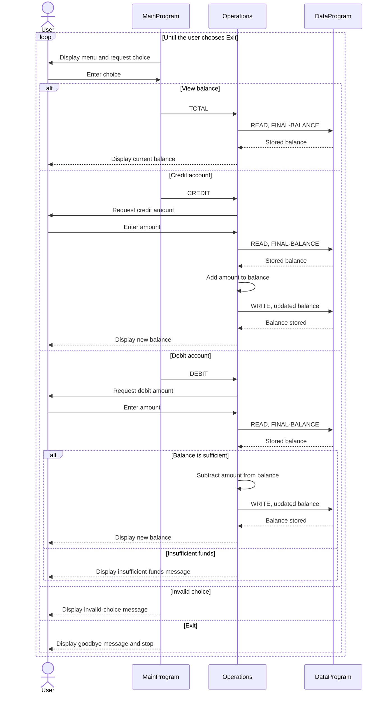

# COBOL Account Management

## Purpose

This program is a small, menu-driven account management example. It maintains one account balance in memory and lets a user view the balance, credit the account, or debit it. Although this exercise concerns student accounts, the current implementation does not store student names, IDs, or separate balances; it operates on a single shared balance.

## Source Files

- [`main.cob`](../src/cobol/main.cob) contains the interactive menu and dispatches the user's selection to the operations program.
- [`operations.cob`](../src/cobol/operations.cob) implements balance display, credits, and debits. It prompts for transaction amounts and calls the data program to read or persist the balance.
- [`data.cob`](../src/cobol/data.cob) owns the balance storage and provides `READ` and `WRITE` operations to retrieve or update it.

## Key Programs and Operations

- `MainProgram` repeatedly displays the menu until the user chooses Exit. Choices 1, 2, and 3 call `Operations` with `TOTAL`, `CREDIT`, and `DEBIT`, respectively. Other choices display an invalid-choice message.
- `Operations` handles the requested action. `TOTAL` reads and displays the balance; `CREDIT` reads an amount, adds it, and writes the new balance; `DEBIT` reads an amount and subtracts it only when sufficient funds are available.
- `DataProgram` accepts an operation and balance through its linkage section. `READ` copies the stored value to the caller; `WRITE` replaces the stored value.

## Student Account Business Rules

- The account balance is initialized to `1000.00`.
- A credit increases the balance by the amount entered.
- A debit is allowed when the current balance is greater than or equal to the requested amount. Otherwise, the program displays an insufficient-funds message and leaves the balance unchanged.
- The balance and transaction amount use COBOL numeric fields with six integer digits and two implied decimal places (`PIC 9(6)V99`).
- The program handles only one account, and the stored balance exists only for the lifetime of the running program.
- The current code does not validate that transaction amounts are positive or that input is valid. In particular, negative amounts are not rejected, so they can reverse the expected effect of a credit or debit. Add validation before using this for real student accounts.

## Sequence Diagram

